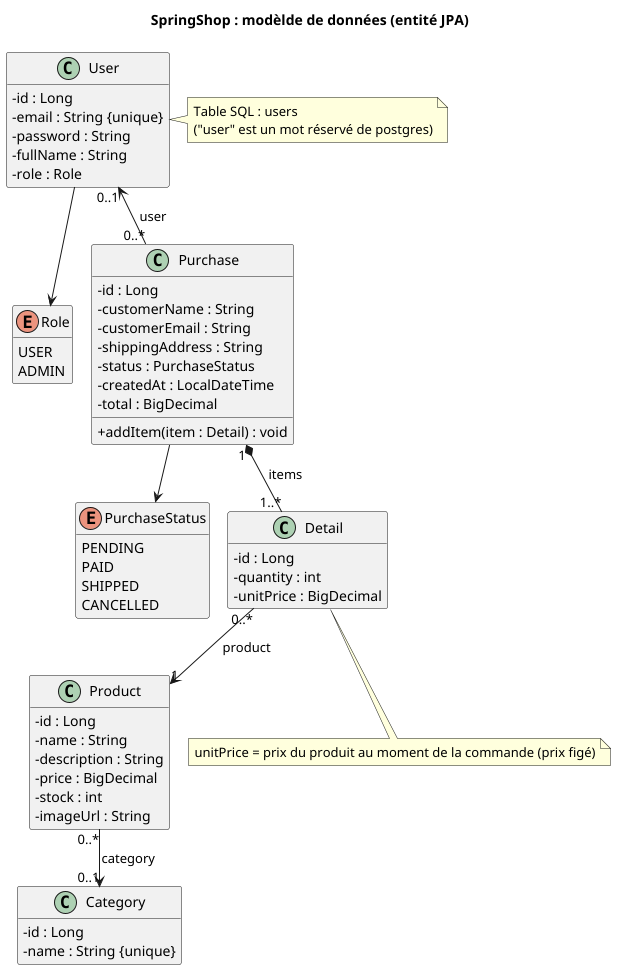

# Documentation

API REST de la boutique : catalogue, comptes, commandes et administration, sécurisée par JWT.

> Package Java : `com.springshop.springshop`. Dans ce document, une **commande** est l'entité `Purchase` et une
> **ligne de commande** est l'entité `Detail`.

[Retour](../README.md)

---

## Sommaire

* [Présentation](#présentation)
* [Prérequis et démarrage](#prérequis-et-démarrage)
* [Structure du code](#structure-du-code)
* [Configuration](#configuration)
* [Modèle de données](#modèle-de-données)
* [API REST](#api-rest)
* [Exemple Postman, Curl]
* [Gestion des erreurs](#gestion-des-erreurs)
* [Tests](#tests)
* [CI/CD]
* [Limites connues](#limites-connues)
* [Frontend](frontend.md)

---

## Présentation

|                  |                              |
|------------------|------------------------------|
| Langage          | Java 21                      |
| Framework        | Spring Boot                  |
| Authentification | JWT, mots de passe en BCrypt |
| Base de données  | PostgreSQL 16                |
| Build            | Maven                        |
| Outils           | Lombok                       |

Principes appliqués dans tout le code :
- **Les entités ne sortent jamais de la couche service** : les contrôleurs ne manipulent que les DTO.
- **La conversion entité → DTP se fait dans la transaction** : `spring.jpa.open-in-view=false` interdit de lire une
  relation `LAZY` après coup.
- **Le total d'une commande et le prix de chaque ligne sont calculés côté serveur** ; le client ne les envoie jamais.

### Cycle de vie d'une requête

```
Requête HTTP
    -> CirsFilter                   (origine autorisée ?)
    -> JwtAuthentificationFilter    (lit le token, authentifie l'utilisateur)
    -> autorisation par route       (SecurityConfig : 401 / 403)
    -> controller                   (@Valid sur le corps : 400 si invalide)
    -> service (@Transactional)     (règle métier, conversion entité -> DTO)
    -> reposiory                    (Spring Data JPA)
    -> PostgreSQL

Toutes excepton levée en cours de route est traduite par une GlobalExceptionHandler.
```

---

## Prérequis et démarrage

**Prérequis** : Java 21, Docker, Docker COmpose.

### Démarrage (backend, frontend, bdd)
```bash
docker compose up -d --build
```

L'application et l'API sont alors disponible sur http://localhost:8080.

### MOde développement

```bash
# base de données seule (tourne sur le port 5432)
docker compose up -d db
# API : tourne sur http://localhot:8080
mvn spring-boot:run
# compiler le jar
mvn package
# exécuter le jar
java -jar target/*.jar
# lancer les tests
mvn test
```

La backend local et la stack Docker complète utilisent le même port 8080 : ne pas les lancer en même temps
(`Port 8080 was already in use` sinon).

Au premier démarrage, Hibernate crée les tables ainsi que le compte administrateur (voir [$4](#4-configuration)).
Vérification :

```bash
docker exec -it springshop-db psql -U springshop -d springshop -c '\dt'
```

Les tables des cinq entités doivent être visibles : `category`, `product`, `users`, `purchase` et `detail` (les noms
dépendent des annotations `@Table` des entités).# 2. Prérequis et démarrage

**Prérequis** : Java 21, Docker, Docker COmpose.

### Démarrage (backend, frontend, bdd)
```bash
docker compose up -d --build
```

L'application et l'API sont alors disponible sur http://localhost:8080.

### MOde développement

```bash
# base de données seule (tourne sur le port 5432)
docker compose up -d db
# API : tourne sur http://localhot:8080
mvn spring-boot:run
# compiler le jar
mvn package
# exécuter le jar
java -jar target/*.jar
# lancer les tests
mvn test
```

La backend local et la stack Docker complète utilisent le même port 8080 : ne pas les lancer en même temps
(`Port 8080 was already in use` sinon).

Au premier démarrage, Hibernate crée les tables ainsi que le compte administrateur (voir [Configuration](#configuration)).
Vérification :

```bash
docker exec -it springshop-db psql -U springshop -d springshop -c '\dt'
```

Les tables des cinq entités doivent être visibles : `category`, `product`, `users`, `purchase` et `detail` (les noms
dépendent des annotations `@Table` des entités).


---

## Structure du code

```
src/main/java/com/springshop/springshop/
├── SpringshopApplication.java
├── config/          DataInitializer
├── controller/      AuthController, CategoryController, ProductController, PurchaseController
├── dto/             AuthResponse, CategoryRequest, CategoryResponse, DetailRequest, DetailResponse,
│                    LoginRequest, ProductRequest, ProductResponse, PurchaseRequest, PurchaseResponse,
│                    RegisterRequest
├── entity/          Category, Detail, Product, Purchase, User
│   └── enums/       PurchaseStatus, Role
├── exception/       BusinessException, GlobalExceptionHandler, NotFoundException
├── repository/      CategoryRepository, ProductRepository, ProductSpecifications,
│                    PurchaseRepository, UserRepository
├── security/        CustomerUserDetailsService, JwtAuthenticationFilter, JwtService, SecurityConfig
└── service/         AuthService, CategoryService, ProductService, PurchaseService
src/main/resources/application.properties
src/test/                    tests et application-test.properties
```

Il n'y a pas de `DetailRepository` : les lignes `Detail` sont enregistrées en cascade avec leur `Purchase`.

| Couche       | Responsabilité                                                                      |
|--------------|-------------------------------------------------------------------------------------|
| `controller` | Expose les routes http, valide les corps, délégue au service, aucune logique métier |
| `service`    | Logique métier, transactions, conversion entité -> DTO                              |
| `repository` | Accès aux données                                                                   |
| `entity`     | Modèle persistant                                                                   |
| `dto`        | Contrats de l'API (`record`)                                                        |
| `security`   | Génération et validation des JWT, filtre, régles d'accès                            |
| `exception`  | Exceptions métier et traduction en réponses http                                    |

**Conventions** : injection par constructeur (`@RequiredArgsConstructor`), services en `@Transaction(readonly = true)` avec
les méthodes d'écriture annotées `@Transactional`.

---

## Configuration

```
spring.application.name=springshop
server.port=8080

# database
spring.datasource.url=jdbc:postgresql://localhost:5432/springshopdb
spring.datasource.username=springshop
spring.datasource.password=<mot-de-passe-à-définit>

spring.jpa.hibernate.ddl-auto=update
spring.jpa.open-in-view=false

# JWT
app.jwt.secret=<clé-en-base64-à-générer>
app.jwt.expiration-ms=86400000

app.admin.email=admin@springshop.com
app.admin.password=<mot-de-passe-à-définir>
app.cors.allowed-origin=http://localhost:4200
```

| Propriété                                         | Rôle                                                                                 | Variable d'environnement (.env)                     |
|---------------------------------------------------|--------------------------------------------------------------------------------------|-----------------------------------------------------|
| `spring.jpa.hibernate.ddl-auto`                   | `update` : crée et complète le schéma au démarrage                                   | -                                                   |
| `spring.jpa.open-in-view`                         | `false` : pas de session JPA pendant le rendu de la réponse                          | -                                                   |
| `app.jwt.secret`                                  | clé de signature en base 64                                                          | `APP_JWT_SECRET`                                    |
| `app.jwt.expiration-ms`                           | durée de vie du token, ici 24h                                                       | `APP_JWT_EXPIRATION_MS`                             |
| `app.admin.email` / `app.admin.password`          | compte administrateur crée au démrrage                                               | `APP_ADMIN_EMAIL` / `APP_ADMIN_PASSWORD`            |
| `app.cors.allowed-origin`                         | origine autorisée à appeler l'API depuis un navigateur, ici Angular (localhost:4200) | `APP_CORS_ALLOWED_ORIGIN`                           |
| `spring.datasource.url` / `username` / `password` | connexion PotsgreSQL                                                                 | `SPRING_DATASOURCE_URL` / `_USERNAME` / `_PASSWORD` |

---

## Modèle de données

[](uml/data.puml)

Toutes les entités utilisent Lombok (`@Getter @Setter @NoArgsConstructor @AllArgsConstructor @Builder`) et une clé primaire
`Long` en `GenerationType.IDENTITY`.

---

## API REST

### Authentification : `/api/auth`

| Méthode | Route       | Accès  | Corps             | Succès               | Erreurs  |
|---------|-------------|--------|-------------------|----------------------|----------|
| POST    | `/register` | public | `RegisterRequest` | `201` `AuthResponse` | 400, 409 |
| POST    | `/login`    | public | `LoginRequest`    | `200` `AuthResponse` | 400, 401 |

### Catégories : `/api/categories`

| Méthode | Route   | Accès  | Corps             | Succès      | Erreurs                 |
|---------|---------|--------|-------------------|-------------|-------------------------|
| GET     | `/`     | public |                   | `200` liste |                         |
| POST    | `/`     | ADMIN  | `CategoryRequest` | `201`       | 400, 401, 403, 409      |
| PUT     | `/{id}` | ADMIN  | `CategoryRequest` | `200`       | 400, 401, 403, 404, 409 |
| DELETE  | `/{id}` | ADMIN  |                   | `204`       | 401, 403, 404, 409      |

### Produits : `/api/products`

| Méthode | Route | Accès | Corps | Succès | Erreurs |
|---|---|---|---|---|---|
| GET | `/` | public | | `200` page de produits | |
| GET | `/{id}` | public | | `200` | 404 |
| POST | `/` | ADMIN | `ProductRequest` | `201` | 400, 401, 403, 404 |
| PUT | `/{id}` | ADMIN | `ProductRequest` | `200` | 400, 401, 403, 404 |
| DELETE | `/{id}` | ADMIN | | `204` | 401, 403, 404, 409 |

Paramètres de `GET /api/products` :

| Paramètre    | Défaut | Description                                                                                      |
|--------------|--------|--------------------------------------------------------------------------------------------------|
| `q`          | :      | Nom contenant le texte (insensible à la casse)                                                   |
| `categoryId` | :      | Produits de cette catégorie. Se combine avec `q`.                                                |
| `page`       | `0`    | Index de page, base 0                                                                            |
| `size`       | `12`   | Borné entre 1 et 50                                                                              |
| `sort`       | `name` | `name`, `price` ou `id` ; toute autre valeur est remplacée par `name`. Tri croissant uniquement. |

```bash
curl "http://localhost:8080/api/products?q=clean&categoryId=2&page=0&size=12&sort=price"
```

### Commandes : `/api/purchases`

| Méthode | Route | Accès | Paramètres / corps | Succès | Erreurs |
|---|---|---|---|---|---|
| POST | `/` | connecté | `PurchaseRequest` | `201` `PurchaseResponse` | 400, 401, 404 (produit), 409 (stock) |
| GET | `/me` | connecté | | `200` liste | 401 |
| GET | `/` | ADMIN | | `200` liste (non paginée) | 401, 403 |
| GET | `/{id}` | ADMIN | | `200` | 401, 403, 404 |
| PATCH | `/{id}/status` | ADMIN | `?status=PENDING\|PAID\|SHIPPED\|CANCELLED` | `200` | 400, 401, 403, 404 |

- L'utilisateur d'une commande est **toujours celui du token** : un client ne peut pas commander au nom de quelqu'un d'autre.
- `/me` est une route littérale : Spring la privilégie sur `/{id}`.

---

## Gestion des erreurs

`GlobalExceptionHandler` (`@RestControllerAdvice`) renvoie des objets `ProblemDetail` (RFC 9457).

| Exception                                      | Statut  | Contenu                                                                    |
|------------------------------------------------|---------|----------------------------------------------------------------------------|
| `MethodArgumentNotValidException` (validation) | **400** | `detail: "Données invalides"` + `errors: { champ: message }`               |
| `BadCredentialsException`                      | **401** | « Email ou mot de passe incorrect »                                        |
| `NotFoundException`                            | **404** | message métier                                                             |
| `BusinessException`                            | **409** | message métier (stock insuffisant, email déjà utilisé)                     |
| `DataIntegrityViolationException`              | **409** | « Opération impossible : cet élément est utilisé ailleurs ou existe déjà » |

Une validation échouée ajoute `errors` :

```json
{
    "status": 400, "detail": "Données invalides",
    "errors": { "price": "doit être supérieur à 0", "name": "ne doit pas être vide" }
}
```

Les cas non prévus (statu inconnu dans `?status=`, etc...) renvoient le format d'erreur par défaut de Spring Boot avec un
`400`. Uen erreur inattendue renvoie un `500`.

---

## Tests

Le profil `test` (`src/test/resources/application-test.properties`) utilise une base **H2 en mémoire en mode PostgreSQL**, avec un secret JWT et un administrateur dédiés. Aucun Docker n'est nécessaire. `ApiTestSupport` lit les identifiants de l'administrateur dans la configuration active (`@Value("${app.admin.email}")`), pour qu'ils restent toujours alignés avec `DataInitializer`.

Dépendances de test : `spring-boot-starter-test`, `spring-security-test`, `h2` (portée `test`).

| Classe | Package | Nature | Couverture |
|---|---|---|---|
| `PurchaseServiceTest` | `service` | Unitaire (Mockito) | Total et prix figé, décrément du stock, plusieurs lignes, lien avec l'utilisateur, stock insuffisant, produit ou utilisateur inconnu, changement de statut |
| `AuthApiTest` | `api` | API (MockMvc) | Inscription, email déjà pris, validation, connexion, mauvais mot de passe, utilisateur inconnu |
| `SecurityRulesApiTest` | `api` | API | Routes publiques, `401` sans token ou avec token invalide, `403` pour un `USER`, accès `ADMIN` |
| `CatalogApiTest` | `api` | API | CRUD produit, validation, `404`, recherche combinée, jokers échappés, pagination, suppression réservée à l'admin |
| `PurchaseApiTest` | `api` | API | Total et stock, `409` sans modification du stock, `404`, `400`, isolation de `/purchases/me`, changement de statut réservé à l'admin |

`ApiTestSupport` (package `api`) est la base commune : contexte Spring complet (sécurité JWT comprise), `MockMvc`, et des utilitaires (`adminToken()`, `newUserToken()`, `createCategory()`, `createProduct()`). Chaque test s'exécute dans une transaction annulée à la fin : ils sont indépendants.

```bash
./mvnw verify                              # tous les tests (34)
./mvnw -Dtest=PurchaseServiceTest test     # une classe
```

---

## Limites connues

| Sujet                | Constat                                                                                                                                                                                                                                                                                |
|----------------------|----------------------------------------------------------------------------------------------------------------------------------------------------------------------------------------------------------------------------------------------------------------------------------------|
| Longueurs de champs  | Les colonnes texte sont en `varchar(255)` mais plusieurs DTO n'imposent aucune longueur maximale : une adresse, un nom ou une URL d'image trop longs provoquent un `500` au lieu d'un `400`. Correctif : `@Size(max = 255)` sur `name`, `imageUrl`, `customerName`, `shippingAddress`. |
| Page négative        | `GET /api/products?page=-1` provoque un `500`. Correctif : `PageRequest.of(Math.max(page, 0), …)`.                                                                                                                                                                                     |
| Stock et concurrence | La vérification puis le décrément ne sont pas verrouillés : deux commandes simultanées sur le dernier exemplaire peuvent réussir toutes les deux. Piste : verrou optimiste (`@Version`) ou `UPDATE … WHERE stock >= ?`.                                                                |
| Annulation           | Passer une commande en `CANCELLED` ne remet pas le stock à jour.                                                                                                                                                                                                                       |
| Paiement             | Inexistant : le statut `PAID` se change à la main.                                                                                                                                                                                                                                     |
| Requêtes N+1         | Le chargement des commandes charge les lignes et les produits une requête à la fois. Piste : `@EntityGraph` sur les lignes et leurs produits.                                                                                                                                          |
| Listes               | `GET /api/purchases` n'est pas paginé.                                                                                                                                                                                                                                                 |
| Jeton                | Un seul token de 24 h, sans refresh ni révocation.                                                                                                                                                                                                                                     |
| Anti-abus            | Pas de limitation de débit sur la connexion et l'inscription.                                                                                                                                                                                                                          |
| Schéma               | `ddl-auto=update` n'applique jamais de changement de type ou de longueur sur une colonne existante. Pour la production : migrations Flyway.                                                                                                                                            |

